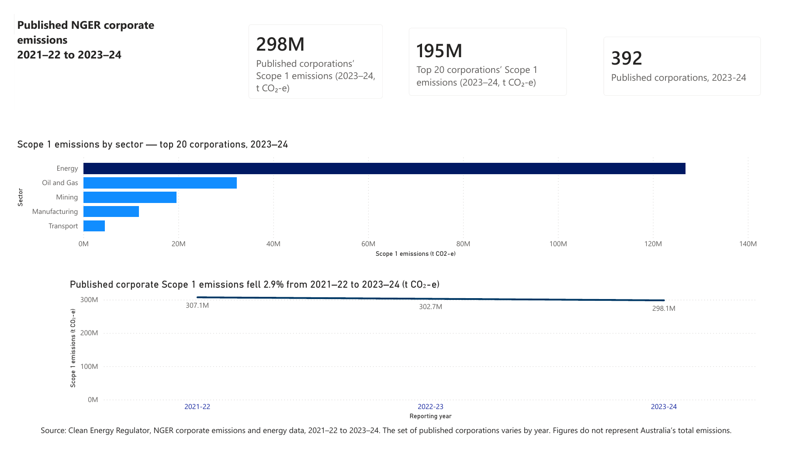
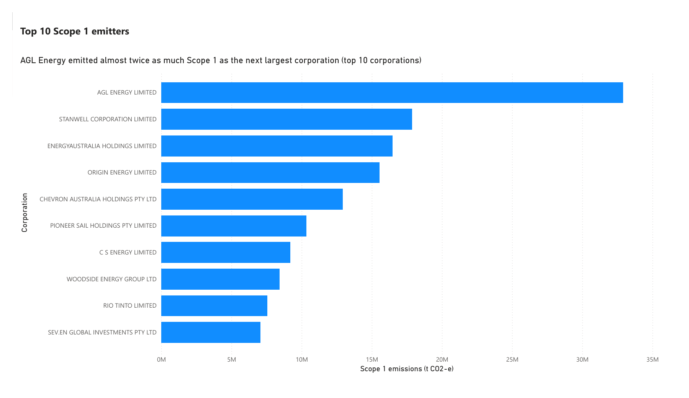
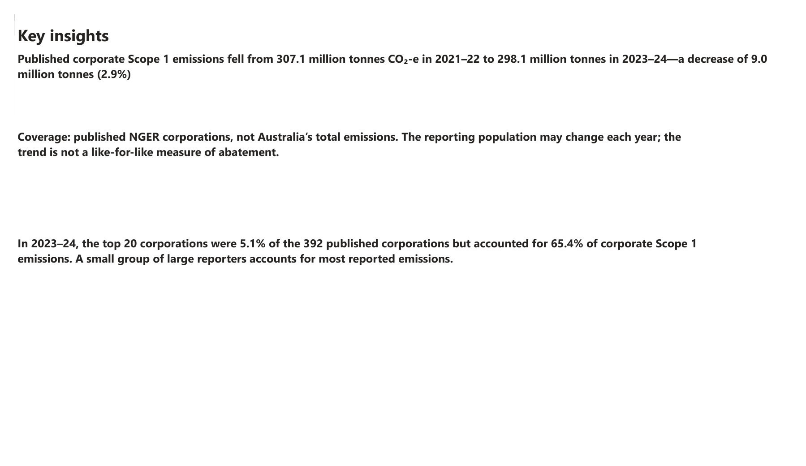

# Published NGER Corporate Scope 1 Emissions Analysis (2021–22 to 2023–24)

An independent Power BI project using published Clean Energy Regulator (CER) corporate emissions data. It looks at how Scope 1 emissions changed over three reporting years, which sectors emit the most, and how concentrated emissions are among the largest reporters.

## Key findings

- **Emissions fell slightly.** Published corporate Scope 1 emissions went from 307.1 million tonnes CO₂-e in 2021–22 to 298.1 million tonnes in 2023–24, a decrease of 9.0 million tonnes (2.9%).
- **A small group emits most.** In 2023–24, the top 20 corporations were 5.1% of the 392 published corporations, but accounted for 65.4% of corporate Scope 1 emissions.
- **Energy is the largest sector.** The energy sector emits 3 to 4 times more Scope 1 emissions than any other sector in every year from 2021–22 to 2023–24.
- **One corporation stands out.** AGL Energy emitted almost twice as much Scope 1 as the next largest corporation among the top 10 emitters.

## Report pages

| Page | What it shows |
|---|---|
| Overview | Headline figures, emissions by sector and the three-year trend |
| Trends | Scope 1 emissions by sector and reporting year |
| Top Emitters | The 10 largest corporate Scope 1 emitters |
| Insights | Key findings and coverage notes |

View all page screenshots

## Data source

Clean Energy Regulator, [NGER reporting data and registers](https://cer.gov.au/markets/reports-and-data/nger-reporting-data-and-registers): published corporate emissions and energy data, 2021–22 to 2023–24.

## Data limitations

- The data covers **published NGER reporting corporations only**. It does not represent Australia's total emissions.
- The set of published corporations **changes each year**, so the trend is not a like-for-like measure of emissions reduction.
- Imported totals were checked for internal consistency. A full reconciliation against the original CER publications (corporation counts, top 20 rankings and concentration figures) is the next planned step.

## Design choices

- Chart titles state the main finding, so a reader can understand each chart in a few seconds.
- The trend chart's axis starts at zero, so the size of the 2.9% decrease is shown honestly.
- Coverage and comparability notes are shown on the report itself, not only in this README.

## Files

- [`NGER_Scope1_Analysis.pbix`](NGER_Scope1_Analysis.pbix): Power BI report (open in Power BI Desktop)
- [`NGER_Scope1_Analysis.pdf`](NGER_Scope1_Analysis.pdf): PDF version, no Power BI needed

## Tools

Microsoft Power BI Desktop.

## About

Built by Saif Rehman as an independent portfolio project. This is not an official Clean Energy Regulator report.
